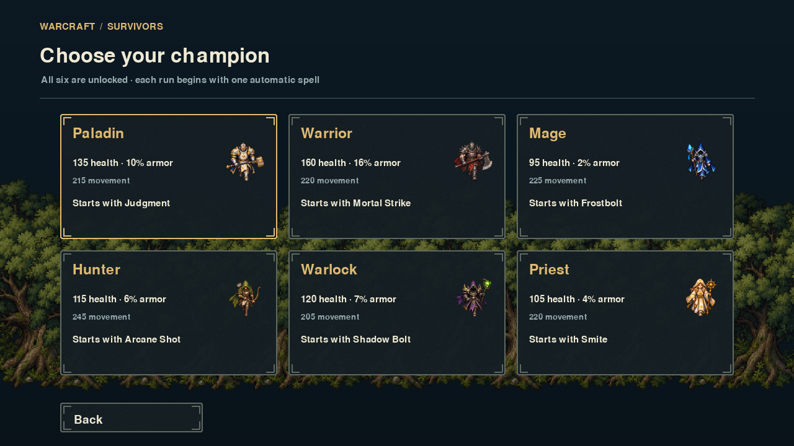
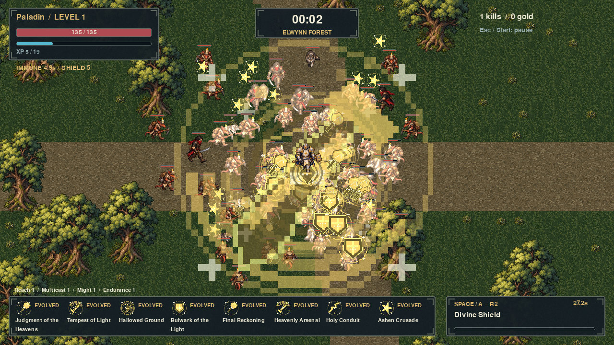
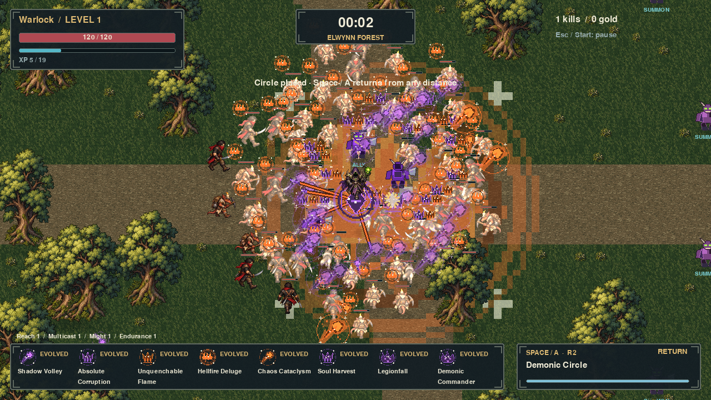
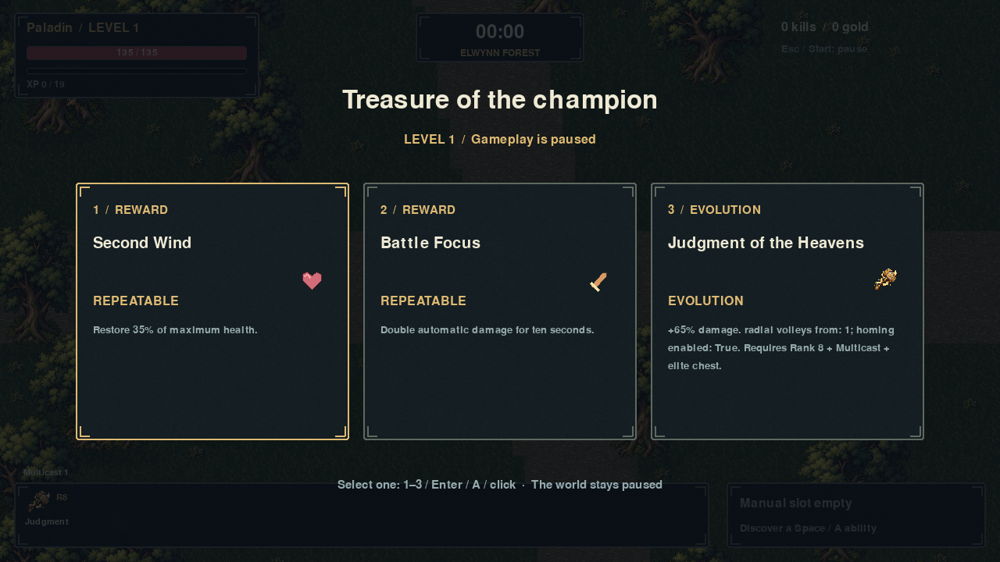
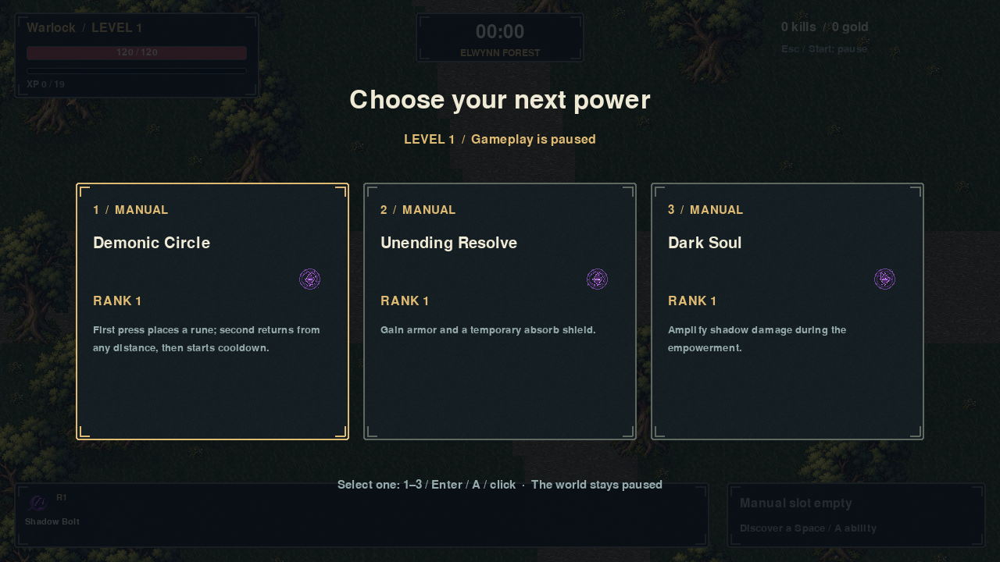

# Milestone 2 - implementation report

Version 0.2.0 implements the full requested six-class ability milestone. `GAME_DESIGN.md` describes the current rules; `CONTENT_CATALOG.md` lists every automatic spell, all 480 rank records, all 60 evolutions, their required passives, all 18 manuals and passive applicability. `MILESTONE2_REQUEST.md` preserves the exact request. The requested implementation order was shared behaviors/tests, Paladin, Warrior, Mage, Hunter/pets, Warlock/pets, Priest, manuals, passives, then evolution/integration.

## Implemented

- Six unlocked class cards with original recognizable animated sprites, distinct starting statistics and the prescribed single starting spell.
- Eleven reusable automatic behavior strategies with data-selected aiming/homing, spreads/radial volleys, arcs/disks, pierce/bounce/return, orbiting weapons, moving/following/persistent fields, expanding waves, chains, statuses, permanent companions, charging summons and repeated beams.
- All sixty automatic spells function at Rank 1 while stationary, have eight improving ranks and their own evolved name/definition/art. Native detailed hammer/shield/rune/frost/shadow assets remain in use; supplemental effects are original offline pixel artwork.
- All eighteen manual abilities are discoverable, have three ranks, one slot, Space/gamepad A activation and visible cooldowns. Mobility uses movement direction or last facing. Circle placement/return works from any distance. Healing, shields, armor, immunity, rooted regeneration, temporary health, school-specific buffs, companion buffs and fear have real effects.
- Hunter and Warlock companions have no health/targeting identity, remain leashed, attack autonomously, scale with applicable upgrades and grant owner kills/XP. Temporary charging summons expire and use swept hits.
- Twelve five-rank shared passives, eight passive slots, explicit applicability. Eight automatic slots. Weighted distinct choices handle caps, one-manual restrictions, mutually exclusive branches, evolved originals and exhausted pools. Cards pause all simulation and stale selections are rejected.
- Minimal five-minute elite Defias champions with guaranteed chests provide reachable evolution rewards. Rank 8 + required passive + eligible chest selection replaces the original slot and cleans original projectiles/fields/pets.
- Selected-class reward recording, expanded spell/manual/status HUD, cached field/summon/status/evolution visuals, readable hero layering and paginated asset preview.
- Existing keyboard/mouse/stick movement, normalization, scrolling map, smooth camera, enemies, damage/immunity, XP, save recovery and protected source-only development tools remain working.

## Files changed

| Area | Files |
|---|---|
| Runtime content/state | `src/warcraft_survivors/content.py`, `entities.py`, `data/content.json`, `__init__.py` |
| Combat/progression | `combat.py`, new `manuals.py`, `simulation.py`, `upgrades.py`, `world.py` (spatial iteration) |
| Frontend/visuals | `app.py`, `rendering.py`, `asset_manager.py`, bundled `assets/manifest.json`, new ability/evolution/manual PNGs, demon/wolf atlases and icons |
| Content/art tooling | new `scripts/build_content.py`, `build_ability_assets.py`, `catalog.py`; updated `build_assets.py`, `preview_assets.py` |
| Validation/release | new `verify_milestone2.py`; updated `benchmark.py`, `check.ps1`, `verify_build.py`, `package.ps1`, `pyproject.toml` |
| Tests | new `tests/test_behaviors.py`, `test_ability_catalog.py`; updated `test_combat.py`, `test_upgrades.py`, `test_app.py`, `test_assets.py` |
| Documentation/evidence | rewritten `README.md`, `ARCHITECTURE.md`, `MILESTONES.md`, `QA.md`; new `GAME_DESIGN.md`, `CONTENT_CATALOG.md`, this report and preserved request; appended `ASSET_CREDITS.md`, `ASSET_PIPELINE.md`; screenshots and private QA artifacts |

No Git repository was present, so no commit or PR was created. Ordinary user saves were not used by smoke/soak/screenshot harnesses. Historical reports and the previous release archive are preserved.

## Known limitations

- This completes Milestone 2, not the full master game: the run remains endless, with no final boss, 30-minute victory, talent/shop screens, new maps or expanded unlock system.
- The elite is a marked, tougher Defias champion with contact combat, providing the required chest source. Dedicated elite/boss attack designs belong to a later milestone.
- The fifty-plus supplemental effect designs and demon animation poses are procedural original pixel artwork. They are readable and animated but need a later production-art/animation pass. Dense empowered combat can still be visually busy.
- Benchmarks use dummy SDL and immortal test enemies; they measure CPU work, not hardware-display FPS. A maximized Mage at 900 enemies exceeds the 16.67 ms frame budget. Ordinary-density testing is reported separately.
- Controller event/navigation/analog/manual behavior is tested with synthetic events; physical gamepad hardware was not certified in this environment.
- Terrain steering remains local rather than global pathfinding. Active runs do not resume after exit. Old DoT snapshots can finish after evolution; the original spell cannot be offered again.

## Play

From the project folder:

```powershell
.\.venv\Scripts\python.exe run_game.py
```

Choose a class, move with WASD/arrows/held mouse/left stick, collect XP and choose upgrades. Space/A activates the equipped manual. For a direct Mage start use `--demo --class mage`. Windows distribution: `dist/WarcraftSurvivors/WarcraftSurvivors.exe` with its `_internal` directory, or the complete `WarcraftSurvivors-0.2.0-Windows.zip`.

## Screenshots











Gameplay screenshots use staged immortal enemy waves and explicitly equipped evolved loadouts; they illustrate systems rather than ordinary starting equipment. Unstaged source/executable smoke screenshots are under `artifacts/milestone2/`.

## Verification results

- Ruff lint/format passed; strict mypy passed for 20 source modules.
- 494 pytest tests passed. Every base spell, maximum-rank spell, evolved form and manual rank has functional coverage.
- All bundled raster metadata/alpha/poses/anchors validated.
- All six source classes launched for 180 frames successfully.
- Six 120-second progression soaks reached levels 10-13, with 180-183 kills each.
- Dense 1920x1080 measurements and limitations are in `QA.md`; 400 enemies averaged about 9-11 ms per frame across the classes. The 900-enemy Mage averaged 22.94 ms (28.48 ms P95); Hunter with pets/summons averaged 16.82 ms (19.59 ms P95).
- PyInstaller rebuilt the Windows executable successfully. Packaged raster validation and all six 180-frame class launches passed with exit code 0; packaged `--debug` was rejected with exit code 2.
- Fourteen paginated preview sheets rendered all 13 actors and 138 automatic/evolved/manual effects; the basic environment/effect gallery pages also rendered.
- The complete v0.2.0 release ZIP includes the runtime, catalog, report, QA and screenshot documentation. No next milestone was started.
